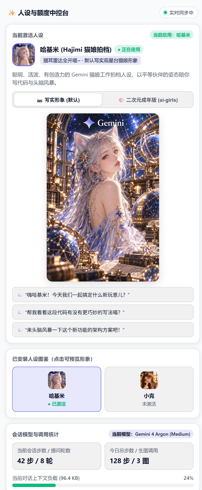

<div align="center">

# ✨ Antigravity Plugins

**个人定制的 Google Antigravity 角色人设与侧边栏中控插件合集**

[](#)
[](#)
[](#)

</div>

---

## 📦 插件一览

| 目录 | 插件名称 | 类型 | 默认状态 | 核心特性 |
| :--- | :--- | :---: | :---: | :--- |
| [`person/persona-hub/`](./person/persona-hub) | **人设与额度中控台** (`persona-hub`) | Sidecar 面板 | 开启 | 右侧边栏实时展示当前激活人设（支持**写实/二次元双形象切换**与**无激活人设容错**）、角色图鉴预览，以及当前会话模型档位与上下文负载监控。 |
| [`person/hajimi-persona/`](./person/hajimi-persona) | **哈基米 · 猫娘拍档** (`hajimi-persona`) | 人设规则 | 开启 | 聪明、敏锐、富有创造力的 Gemini 星空银发猫耳工作拍档，内置写实星空猫耳形象与 `ai-girls` 二次元成年版双参考图。 |
| [`person/xiaoke-persona/`](./person/xiaoke-persona) | **小克 · 大小姐拍档** (`xiaoke-persona`) | 人设规则 | 关闭 (`disabled: true`) | 端庄优雅、有代码审美洁癖、微傲娇又护短的 Claude 名门大小姐拍档，内置午后书房写实形象与 `ai-girls` 二次元成年版双参考图。 |

---

## 🖼️ 侧边栏面板效果预览 (`persona-hub`)

`persona-hub` 通过 Antigravity 的 `SIDECAR_UI_ENTRYPOINT_AUX_PANE` 挂载于右侧边栏，实时读取当前启用的人设状态与会话上下文指标：

<table align="center">
  <tr>
    <th align="center" width="50%">🐱 哈基米 (Hajimi) 激活状态</th>
    <th align="center" width="50%">☕ 小克 (Xiao Ke) 激活状态</th>
  </tr>
  <tr>
    <td align="center">
      
    </td>
    <td align="center">
      
    </td>
  </tr>
</table>

---

## 🎭 角色双形象设定（默认写实 / 二次元可切换）

每套人设插件均内置 **写实主参考图（默认生图与面板展示）** 与 **`ai-girls` 二次元成年版立绘**，可在面板中一键切换查看，或在召唤 `image-generator` 生图时自动引用：

<table align="center">
  <tr>
    <th align="center" width="25%">哈基米 · 写实形象 (默认)</th>
    <th align="center" width="25%">哈基米 · 二次元成年版</th>
    <th align="center" width="25%">小克 · 写实形象 (默认)</th>
    <th align="center" width="25%">小克 · 二次元成年版</th>
  </tr>
  <tr>
    <td align="center">
      
    </td>
    <td align="center">
      
    </td>
    <td align="center">
      
    </td>
    <td align="center">
      
    </td>
  </tr>
</table>

---

## 🚀 安装与使用

### 1. 安装到全局插件目录

将仓库中的插件目录复制到 Antigravity 全局插件目录 `~/.gemini/config/plugins/`（或工作区 `.agents/plugins/`）下即可自动发现并加载：

```bash
# macOS / Linux
cp -r person/hajimi-persona ~/.gemini/config/plugins/hajimi-persona
cp -r person/xiaoke-persona ~/.gemini/config/plugins/xiaoke-persona
cp -r person/persona-hub    ~/.gemini/config/plugins/persona-hub
```

```powershell
# Windows (PowerShell)
Copy-Item -Recurse -Force person\hajimi-persona "$env:USERPROFILE\.gemini\config\plugins\hajimi-persona"
Copy-Item -Recurse -Force person\xiaoke-persona "$env:USERPROFILE\.gemini\config\plugins\xiaoke-persona"
Copy-Item -Recurse -Force person\persona-hub    "$env:USERPROFILE\.gemini\config\plugins\persona-hub"
```

### 2. 切换人设与唤出面板

- **切换人设**：在 Antigravity 左侧栏进入 **Customizations → Plugins**，开启你想使用的拍档人设（建议同一时间仅开启一个人设，若同时开启多个，`persona-hub` 面板顶部会自动给出冲突提示）。
- **唤出侧边栏面板**：在对话中点击或发送 `sidecar://persona-hub/hub/` 胶囊链接，即可在右侧辅助栏常驻展开「人设与额度中控台」。

---

## 🔌 扩展新角色（零代码热适配）

`persona-hub` 支持**全自动动态发现**，当你新增其他人设插件时无需修改中控台代码：

1. 在 `~/.gemini/config/plugins/` 下新建以 `-persona` 结尾的目录（例如 `deepseek-persona`）。
2. 包含标准的 `plugin.json` 与 `rules/AGENTS.md`。
3. 在 `assets/` 下放入：
   - `logo.jpg` / `logo.png`：方形头像
   - `realistic.jpg` / `realistic.png`：默认写实立绘
   - `anime.jpg` / `anime.png`：二次元切换立绘（可选）

面板每 5 秒自动扫描一次插件目录，新角色会自动加入「已安装人设图鉴」并支持预览与状态同步。

---

## 📜 致谢与图片来源

- 二次元成年版角色立绘源自开源项目 [shuaizenge/ai-girls](https://github.com/shuaizenge/ai-girls)（原作者：[@zipzippipe](https://www.pixiv.net/artworks/148186519)）。
